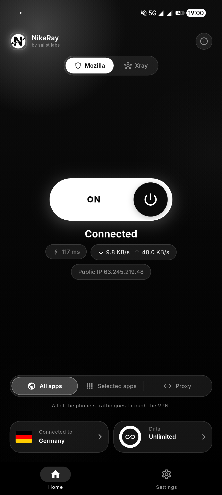
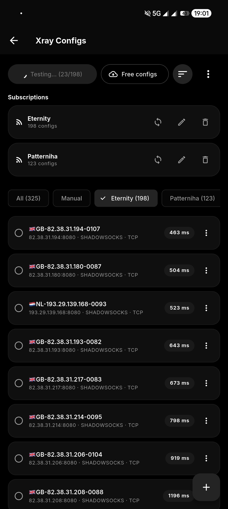
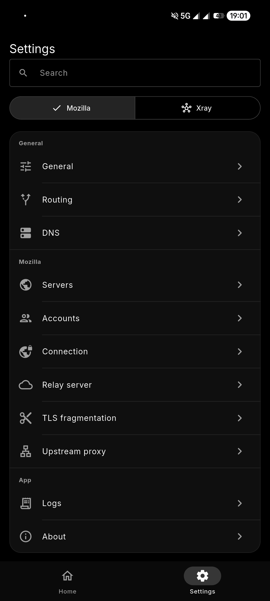

# نیکاری (NikaRay - اندروید)

[English](README.md) | [فارسی](README.fa.md) | [Русский](README.ru.md)

**نیکاری (NikaRay)** یک کلاینت VPN اندروید با رابط کاربری مونوکروم و دو هسته مجزا است:
- **Mozilla** (هسته داخلی با پشتیبانی از تغییر مسیر و رله)
- **Xray** (`xray-core` با پشتیبانی از VLESS Reality/XHTTP، VMess، Trojan، Shadowsocks، SOCKS5، HTTP، **Hysteria2** و ایمپورت **Clash / Mihomo YAML**)

## تصاویر محیط برنامه

> اسکرین‌شات‌های برنامه را با نام‌های زیر در پوشه [`docs/screenshots/`](docs/screenshots/) قرار دهید:

| صفحه اصلی (Mozilla / Xray) | لیست کانفیگ‌ها و پینگ زنده | تنظیمات |
| :---: | :---: | :---: |
|  |  |  |

## قابلیت‌ها

- **دو تب مجزا در صفحه اصلی و تنظیمات**: جابه‌جایی سریع بین **Mozilla** و **Xray** با تنظیمات عمومی مشترک.
- **حالت‌های اتصال Xray**:
  - **دستی (Manual)**: اتصال به کانفیگ انتخاب‌شده توسط کاربر.
  - **بهترین پینگ (Best Ping)**: تست نودها با `https://cp.cloudflare.com/generate_204`، اتصال خودکار به کمترین پینگ و جابه‌جایی خودکار در صورت قطعی.
- **مدیریت کامل کانفیگ‌ها و سابسکریپشن‌ها**:
  - پشتیبانی از لینک‌های `vless://`، `vmess://`، `trojan://`، `ss://`، `socks://`، `hysteria2://`، `hy2://`، سابسکریپشن Base64، JSON و **Clash / Mihomo YAML** (`proxies:`).
  - نمایش لحظه‌ای پینگ هر نود هنگام تست و مرتب‌سازی پیش‌فرض بر اساس کمترین پینگ.
  - بخش **کانفیگ رایگان** با خواندن لیست از فایل `configs.json` در گیتهاب.
- **بررسی خودکار بروزرسانی**: بررسی خودکار GitHub Releases هنگام باز شدن برنامه برای دریافت `NikaRay-Android-<abi>.apk`.

## ساخت از سورس (اندروید)

### پیش‌نیازها
- Go 1.24+ به همراه `gomobile` و `gobind`
- Flutter SDK
- Android SDK و NDK (نسخه ثبت‌شده در `app/android/app/build.gradle.kts`)

### دستور بیلد
```powershell
.\scripts\build-android.ps1
```
فایل‌های APK خروجی برای معماری‌های `arm64-v8a`، `armeabi-v7a` و `x86_64` در پوشه `dist/` ساخته می‌شوند.
