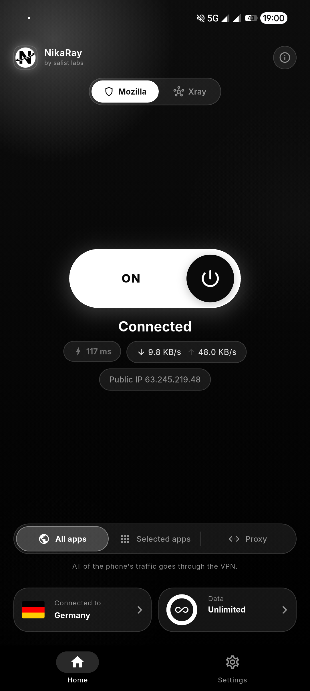
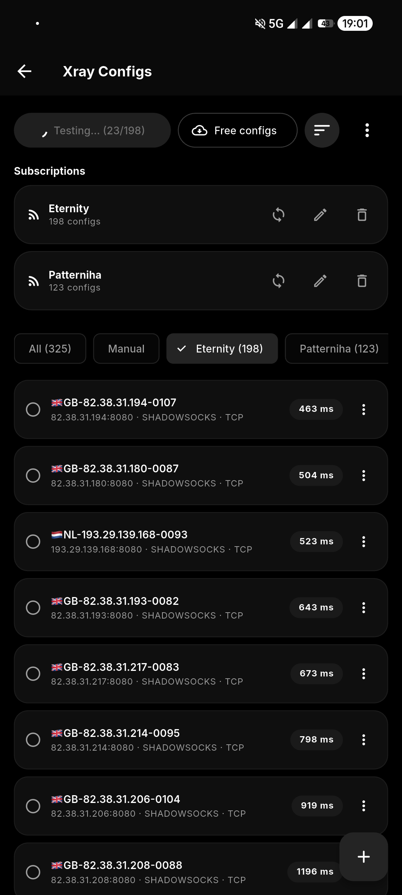
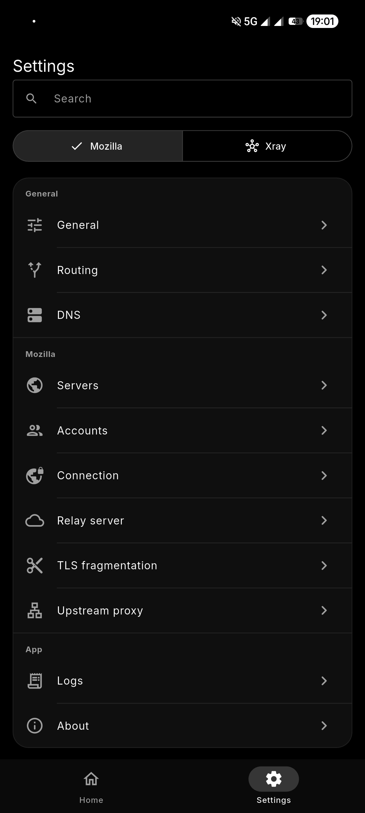

# NikaRay (Android)

[English](README.md) | [فارسی](README.fa.md) | [Русский](README.ru.md)

**NikaRay** is an Android VPN client with a monochrome UI, powered by dual engines:
- **Mozilla** (built-in WARP/WireGuard + evasion & relay modes)
- **Xray** (`xray-core` with VLESS Reality/XHTTP, VMess, Trojan, Shadowsocks, SOCKS5, HTTP, **Hysteria2**, and **Clash / Mihomo YAML** import)

## Screenshots

> Place your app screenshots in [`docs/screenshots/`](docs/screenshots/) with the filenames below:

| Home (Mozilla / Xray) | Xray Configs & Live Ping | Settings |
| :---: | :---: | :---: |
|  |  |  |

## Features

- **Dual Engine Tabs**: Switch cleanly between **Mozilla** and **Xray** on the Home screen and in Settings (with shared General settings).
- **Xray Connection Modes**:
  - **Manual**: Connect to the selected profile.
  - **Best Ping (Auto)**: Tests profiles against `https://cp.cloudflare.com/generate_204`, connects to the lowest-latency server, and automatically fails over on disconnect.
- **Full Config & Subscription Manager**:
  - Import URIs (`vless://`, `vmess://`, `trojan://`, `ss://`, `socks://`, `hysteria2://`, `hy2://`), Base64 subscriptions, Xray JSON, and **Clash / Mihomo YAML** (`proxies:`).
  - Live streaming delay test with automatic lowest-latency sorting.
  - Built-in **Free Configs** catalog loaded from `configs.json` in this repository.
- **Auto-Update Check**: Checks GitHub Releases (`sl-HapY/nikaray`) on app startup for `NikaRay-Android-<abi>.apk`.

## Building from Source (Android)

### Prerequisites
- Go 1.24+ & `gomobile` / `gobind`
- Flutter SDK
- Android SDK + NDK (see `app/android/app/build.gradle.kts`)

### Build
```powershell
.\scripts\build-android.ps1
```
Output APKs (`arm64-v8a`, `armeabi-v7a`, `x86_64`) will be placed in `dist/`.
