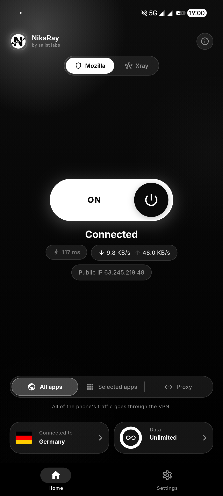
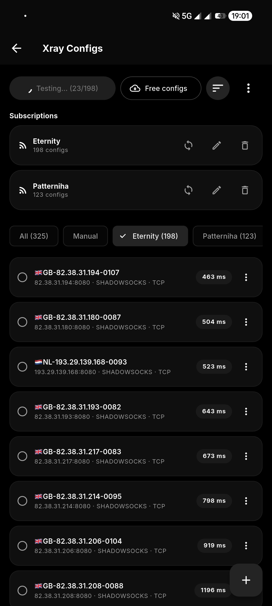
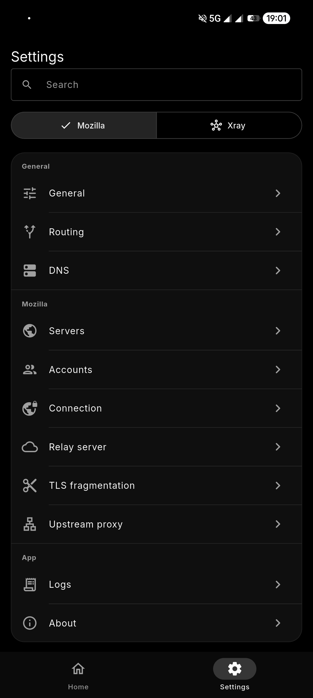

# NikaRay (Android)

[English](README.md) | [فارسی](README.fa.md) | [Русский](README.ru.md)

**NikaRay** — это Android VPN-клиент с монохромным интерфейсом и двумя движками:
- **Mozilla** (встроенный движок с поддержкой обхода блокировок и relay)
- **Xray** (`xray-core` с поддержкой VLESS Reality/XHTTP, VMess, Trojan, Shadowsocks, SOCKS5, HTTP, **Hysteria2** и импорта **Clash / Mihomo YAML**)

## Скриншоты

> Поместите скриншоты приложения в папку [`docs/screenshots/`](docs/screenshots/) со следующими именами файлов:

| Главный экран (Mozilla / Xray) | Конфиги и живой пинг | Настройки |
| :---: | :---: | :---: |
|  |  |  |

## Возможности

- **Две вкладки на главном экране и в настройках**: переключение между **Mozilla** и **Xray** с общими базовыми настройками.
- **Режимы подключения Xray**:
  - **Ручной (Manual)**: подключение к выбранному профилю.
  - **Лучший пинг (Best Ping)**: проверка серверов через `https://cp.cloudflare.com/generate_204`, подключение к узлу с минимальной задержкой и автоматическое переключение при обрыве.
- **Управление конфигами и подписками**:
  - Импорт URI (`vless://`, `vmess://`, `trojan://`, `ss://`, `socks://`, `hysteria2://`, `hy2://`), Base64-подписок, Xray JSON и **Clash / Mihomo YAML** (`proxies:`).
  - Потоковое тестирование задержки с автоматической сортировкой по наименьшему пингу.
  - Встроенный каталог **Бесплатных конфигов** из файла `configs.json` в репозитории.
- **Автопроверка обновлений**: проверка GitHub Releases при запуске приложения для `NikaRay-Android-<abi>.apk`.

## Сборка из исходников (Android)

### Требования
- Go 1.24+ и `gomobile` / `gobind`
- Flutter SDK
- Android SDK и NDK (указана в `app/android/app/build.gradle.kts`)

### Сборка
```powershell
.\scripts\build-android.ps1
```
Готовые APK (`arm64-v8a`, `armeabi-v7a`, `x86_64`) будут сохранены в папке `dist/`.
